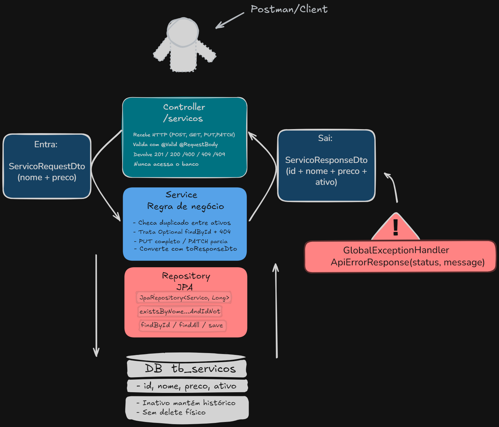

# Barbearia Control API

Projeto de portfólio backend em **Java** e **Spring Boot** para uma barbearia real, focado no aprendizado de modelagem de domínio, regras de negócio, persistência e construção de uma API **REST** a partir de um caso de uso concreto.

## Objetivo

Construir uma API para apoiar o controle interno da barbearia, começando pelo cadastro de **services** e evoluindo futuramente para o registro de **attendances**, controle financeiro simples, estoque básico e assinaturas, caso ainda façam sentido para o negócio.

## V1 – Checklist ✅/❌
- [x] **Services** – cadastro, listagem, busca por ID, edição e inativação (concluído)
- [ ] **Attendances** – registro de atendimentos (service pronto, controller ainda faltando)
- [ ] **Consulta de attendances** (lista e filtros ainda a implementar)
- [ ] **Entradas e saídas de caixa**
- [ ] **Indicadores financeiros**
- [ ] **Produtos e estoque**
- [ ] **Assinantes**

## Escopo da V1

A V1 está sendo desenvolvida em partes, seguindo a ordem planejada:

1. **Services**
2. **Attendances**
3. Consulta de **attendances**
4. Entradas e saídas de caixa
5. Indicadores financeiros
6. Produtos e estoque
7. Assinantes (se ainda houver demanda)

## Estado atual

> **Resumo em tabela** – ajuda a entender de forma rápida o progresso atual.

| Módulo      | Implementado | Testes unitários | Observação |
|-------------|--------------|-------------------|------------|
| Services    | ✅           | ✅ (94)           | pronto para V1 |
| Attendances | ⚙️          | —                 | Service (`AttendanceManager`) pronto, **controller ainda falta** |

Até o momento, foram concluídas as primeiras partes técnicas do módulo **Services**:

- Entidade `ProviderService` configurada para persistência com JPA;
- `ProvidedServiceRepository` para acesso aos dados;
- `ServiceRequestDto` e `ServiceResponseDto` para entrada e saída da API;
- `ServiceManager` contendo os casos de uso de **create**, **list**, **findById**, **edit** e **deactivate**, além do mapeamento entre entidade e DTO (futuramente refatorado);
- `ServiceController` expondo endpoints REST para cadastro, listagem, busca por id, edição e desativação de services;
- `GlobalExceptionHandler` com `@RestControllerAdvice` e `ApiErrorResponse(statusCode, message)` para respostas de erro padronizadas;
- `ActiveNameAlreadyExistsException` como exceção de negócio não checada (`RuntimeException`);
- `ServiceNotFoundException` como exceção de negócio não checada para id inexistente.

### Respostas atuais dos endpoints de **services**

- `201 Created`: service criado, retorna o **ServiceResponseDto**;
- `400 Bad Request`: dados inválidos no DTO, retornando as mensagens de validação consolidadas em `ApiErrorResponse`;
- `409 Conflict`: nome já existente entre services ativos, retornando a mensagem da regra de negócio em `ApiErrorResponse`.

### Listagem atual

- `GET /services` → `200 OK` com a lista de `ServiceResponseDto` (pode ser vazia `[]`);
- `GET /services/{id}` → `200 OK` com o `ServiceResponseDto` quando encontrado e `404 Not Found` (em `ApiErrorResponse`) quando não existe.

### Edição atual

- `PUT /services/{id}` recebe o `ServiceRequestDto` completo e retorna `200 OK` com o DTO de resposta atualizado.
- A edição exige **name** e **suggestedPrice** juntos, mesmo quando só um campo mudou, e não altera o campo **active**.
- A verificação de duplicidade ignora o próprio service, permitindo manter o mesmo nome sem gerar conflito.
- `400 Bad Request`, `404 Not Found` e `409 Conflict` seguem o mesmo padrão de `ApiErrorResponse`.

### Desativação atual

- `PATCH /services/{id}/deactivate` recebe apenas o id na URL (sem corpo) e retorna `200 OK` com o `active = false` no `ServiceResponseDto`.
- A desativação é lógica, sem exclusão física, mantendo o registro no banco para histórico.
- Desativar algo já inativo mantém‑o inativo, sem erro adicional.
- Um novo service pode reutilizar o nome de um service inativo.
- `404 Not Found` para id inexistente, usando `ApiErrorResponse`.

> **Próximo passo:** implementar `AttendanceController` que exponha os métodos do `AttendanceManager` (POST, GET, PATCH, deactivate/reactivate). Enquanto isso, o módulo de atendimentos já pode ser testado diretamente via chamadas ao service em testes ou no console.

## Módulos previstos

- Services
- Attendances
- Entradas e saídas de caixa
- Produtos e estoque básico
- Assinantes
- Indicadores financeiros simples

## Limites da V1

Não fazem parte da primeira versão:

- Agendamento online;
- Automação de WhatsApp;
- Integrações financeiras;
- Pagamentos;
- Aplicativo mobile;
- Gráficos avançados;
- Autenticação avançada (sem decisão explícita).

## Documentação

- `docs/service-requirements-v1.md`: requisitos e anotações de implementação do primeiro módulo.
- `docs/open-decisions.md`: decisões importantes que ainda precisam ser validadas.

## Arquitetura



## Como executar

```bash
# clonar o repositório
git clone https://github.com/IranFatec2108/MajorAPI.git
cd MajorAPI

# iniciar a API (modo desenvolvimento)
./mvnw spring-boot:run

# rodar apenas os testes unitários
./mvnw test