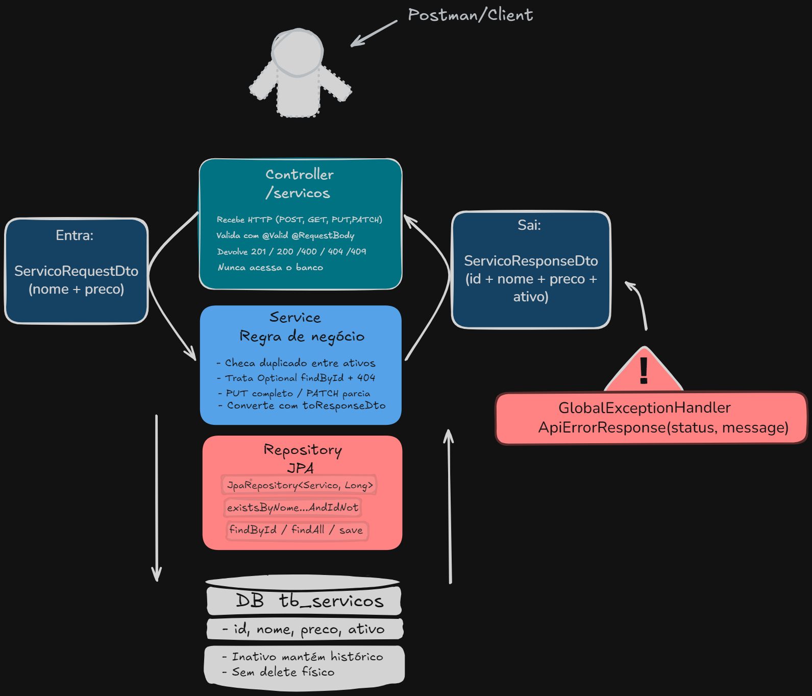

# Barbearia Control API

Projeto de portfólio backend em **Java** e **Spring Boot** para um caso de uso real de barbearia. O objetivo é praticar modelagem de domínio, regras de negócio, persistência e design de API REST, evoluindo o sistema de forma incremental.

## Objetivo

Construir uma API para apoiar o controle interno da barbearia, começando pelos módulos de **Services** e **Attendances** (MVP principal) e evoluindo para fluxo de caixa, estoque básico, assinantes e indicadores financeiros.

## Estado atual (MVP)

| Módulo | Status | Observações |
|---|---|---|
| **Services** | ✅ Completo (V1) | Criar, listar, buscar por ID, atualizar e desativar (soft-delete via `active`). |
| **Attendances** | ✅ Completo (V1) | Registrar, listar/filtrar, buscar por ID, atualizar parcialmente, desativar/reativar (soft-delete via `valid`). |
| **CORS** | ✅ Configurado (dev) | Permite requisições de `http://localhost:5173` para integração com o frontend. |
| **Configuração de banco** | ✅ Baseada em variáveis de ambiente | PostgreSQL configurado via variáveis de ambiente; Hibernate `ddl-auto=none`. |
| **Consultas avançadas de Attendance** | 📋 Planejado | Filtros por data/serviço e paginação (decisões pendentes). |
| **Fluxo de caixa / indicadores** | ❌ Não iniciado | Planejado após estabilização do MVP. |
| **Estoque / assinantes / auth** | ❌ Não iniciado | Iterações futuras. |

## Escopo e progresso da V1

1. **Services** — ✅ concluído
2. **Attendances** — ✅ concluído
3. Melhorias de consulta de Attendance (filtros/paginação) — 📋 planejado
4. Entradas e saídas de caixa — ❌ não iniciado
5. Indicadores financeiros — ❌ não iniciado
6. Produtos e estoque básico — ❌ não iniciado
7. Assinantes (se ainda necessário) — ❌ não iniciado

## Stack técnica

- **Java:** 21
- **Spring Boot:** 4.1.2
- **Persistência:** Spring Data JPA / Hibernate
- **Banco de dados:** PostgreSQL (via variáveis de ambiente)
- **Validação:** Jakarta Bean Validation
- **Build:** Maven (`./mvnw`)

## Estrutura do projeto

```text
src/main/java/br/com/iranfatec/majorapi/
├── attendance/   # Entidade Attendance, controller, manager, repository, DTOs, exceptions
├── service/      # Entidade ProvidedService, controller, manager, repository, DTOs, exceptions
├── exception/    # Tratamento global de erros e resposta padrão da API
└── config/       # CORS e outras configurações
```

## Visão geral da API

### Services (`/services`)
- `POST /services` — Cria um service (`201 Created`)
- `GET /services` — Lista services (`200 OK`)
- `GET /services/{id}` — Busca service por ID (`200 OK` / `404`)
- `PUT /services/{id}` — Atualiza um service (`200 OK`)
- `PATCH /services/{id}/deactivate` — Desativa um service (`200 OK`)

**Regras:** nome único entre services ativos, soft-delete com `active`, sem reativação na V1.

### Attendances (`/api/attendances`)
- `POST /api/attendances` — Registra um attendance (`201 Created`)
- `GET /api/attendances?valid=true|false` — Lista attendances (padrão: válidos), ordenados por `dateTime DESC`
- `GET /api/attendances/{id}` — Busca attendance por ID (`200 OK` / `404`)
- `PATCH /api/attendances/{id}` — Atualiza parcialmente um attendance (`200 OK`)
- `PATCH /api/attendances/{id}/deactivate` — Desativa (soft-delete, `valid=false`)
- `PATCH /api/attendances/{id}/reactivate` — Reativa (`valid=true`)

**Regras:** apenas services ativos podem ser usados em novos attendances, `serviceNameSnapshot` preserva o histórico, `amountPaid >= 0`, `dateTime` é definido na criação.

## Tratamento de erros

Centralizado via `GlobalExceptionHandler` (`@RestControllerAdvice`) com resposta padrão `ApiErrorResponse(statusCode, message)`.

Status comuns:
- `400 Bad Request` — erros de validação
- `404 Not Found` — recurso não encontrado
- `409 Conflict` — conflito de regra de negócio (ex.: nome duplicado entre services ativos)

## Configuração (variáveis de ambiente)

A aplicação carrega variáveis de ambiente de um arquivo local `.env` quando presente (`spring.config.import=optional:file:.env[.properties]`) e também pode recebê-las do ambiente de execução (recomendado para deploy).

Variáveis necessárias:
- `DB_URL` — URL JDBC do PostgreSQL (ex.: `jdbc:postgresql://localhost:5432/majorapi`)
- `DB_USER` — usuário do banco de dados
- `DB_PASSWORD` — senha do banco de dados

> Não faça commit do arquivo `.env` nem de credenciais no repositório. Configure as variáveis de ambiente no provedor de deploy (ex.: Render) para produção.

## Como executar localmente

1. **Pré-requisitos**
   - Java 21
   - Maven (ou use o `./mvnw` incluído)
   - PostgreSQL em execução e um banco criado

2. **Configurar variáveis de ambiente** (exemplo de `.env` na raiz do projeto, não versionado):
   ```env
   DB_URL=jdbc:postgresql://localhost:5432/majorapi
   DB_USER=seu_usuario
   DB_PASSWORD=sua_senha
   ```

3. **Executar a API**
   ```bash
   ./mvnw spring-boot:run
   ```

4. **Executar os testes**
   ```bash
   ./mvnw test
   ```

A API inicia em `http://localhost:8080` por padrão.

## Integração com frontend

Um frontend separado em React (Vite + TypeScript) consome esta API para o MVP (fluxos de CRUD de Services e Attendances). Para desenvolvimento local, o CORS está configurado para permitir `http://localhost:5173`. Em produção, atualize as origens permitidas para a URL do frontend publicado.

## Documentação

- [`docs/requisitos-servicos-v1.md`](docs/requisitos-servicos-v1.md) — Requisitos e notas de implementação do módulo Services
- [`docs/requisitos-attendance.md`](docs/requisitos-attendance.md) — Requisitos e notas de implementação do módulo Attendance
- [`docs/decisoes-em-aberto.md`](docs/decisoes-em-aberto.md) — Decisões de produto/negócio em aberto

## Arquitetura



## Fora de escopo (nesta etapa)

- Agendamento online
- Automação de WhatsApp
- Integrações/pagamentos financeiros
- Aplicativo mobile
- Dashboards/gráficos avançados
- Autenticação/autorização (planejado para iteração futura)